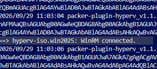
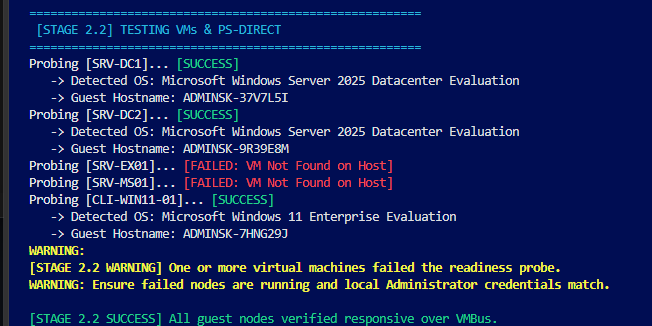

# SK-IT Windows Server 2025 Automation Project:- Project Prerequisites & Deployment Guide

**Quick Links:**  | [Read Me](../README.md) | [Project Customisation](Customise-your-Infrastructure.md) | [pfSense Configuration](PfSense-configuration.md) | [Technical Reference](docs/Technical-Reference.md) |

---

This guide consolidates all prerequisite checks, system dependencies, hypervisor settings, and execution steps into a single walkthrough. Once the prerequisites are configured, you
will have a fully automated Windows Server 2025 domain, enabling you to join clients/servers to your forest with a few lines of code.

See the **[Technical Reference Manual](Technical-Reference.md)** for architecture explanations and additional configurations.

---

### Table of Contents

### ⚡ Quick Start Guide
*Targeted for experienced engineers with Hyper-V, Git, and PowerShell 7 already configured.*

1. 🟩 [STEP 1 — Deploy pfSense Firewall & Isolated Network](#quick-step-1)
2. 🟩 [STEP 2 — Git Clone the Repository](#quick-step-2)
3. 🟩 [STEP 3 — Download Windows ISOs & HashiCorp Packer](#quick-step-3)
4. 🟩 [STEP 4 — Configure Credentials & Validate Checksums](#quick-step-4)
5. 🟩 [STEP 5 — Customise Your Lab Infrastructure](#quick-step-5)
6. 🟩 [STEP 6 — Execute Deployment Orchestrator](#quick-step-6)

### 📘 Beginner Start Guide
*Complete step-by-step path starting from hardware checks to a fully functional, automated, domain.* 

0. 🟪 [STEP 0 — Beginner Introduction](#beginner-start)
1. 🟪 [STEP 1 — Map Hardware, Compute & Storage Capacity](#beginner-step-1)
2. 🟪 [STEP 2 — Install Development Tools & Modern Console](#beginner-step-2)
3. 🟪 [STEP 3 — Enable Hyper-V & Create Virtual Switches](#beginner-step-3)
4. 🟪 [STEP 4 — Deploy pfSense Firewall & Isolated Network](#beginner-step-4)
5. 🟪 [STEP 5 — Git Clone Repository & Install HashiCorp Packer](#beginner-step-5)
6. 🟪 [STEP 6 — Customise Your Lab Infrastructure](#beginner-step-6)
7. 🟪 [STEP 7 — Download Windows ISOs & HashiCorp Packer](#beginner-step-7)
8. 🟪 [STEP 8 — Configure Credentials & Validate Checksums](#beginner-step-8)
9. 🟪 [STEP 9 — Execute Deployment Orchestrator](#beginner-step-9)
10. ⛔ [STEP 10 — Project Troubleshooting & Common Errors](#troubleshooting)

---
<br>

### 🟩 STEP 1 — Deploy pfSense Firewall & Isolated Network <a id="quick-step-1"></a>

This architecture enforces strict Layer 2 isolation and Layer 3 gateway routing by establishing a direct 1:1 mapping between Hyper-V virtual switches and pfSense logical interfaces. 

Follow this video walkthrough to setup the Hyper-V isolated Network: **[How to setup an isolated Hyper-V lab with internet access](http://www.youtube.com/watch?v=eEZZQT8T4xY)**. The pfSense architecture, in this automation project, follows these configurations directly. If you have time and want to know why pfSense was utilised for this automation project, see the **[pfSense Architecture Guide](PfSense-configuration.md)**.

#### pFsense Interface & Switch Mapping:
* **`lab-switch-wan` $\rightarrow$ `hn0` $\rightarrow$ WAN (`192.168.0.x/24`):** Binds to an **External** Hyper-V virtual switch attached to your physical network adapter to receive an IP via DHCP from your home or office router, supplying outbound internet routing [YT: 00:02:20, 00:07:30].
* **`lab-switch-lan` $\rightarrow$ `hn1` $\rightarrow$ LAN (`10.0.0.254/24`):** Binds to a **Private** Hyper-V virtual switch [YT: 00:02:46, 00:08:12]. This completely isolates internal lab traffic from your production physical network, serving as the default gateway for all lab virtual machines [YT: 00:02:53, 00:09:44].

#### Critical Pre-run Checklist:
1. **Match Switch Names Exactly:** Verify that your Hyper-V switch names match `lab-switch-wan` and `lab-switch-lan` with no trailing spaces or case differences, as defined in `$VMList` (`01_SK_Automation-Host_CreateVM.ps1`) and `variables.pkr.hcl`.
2. **Disable pfSense DHCP on LAN:** In the pfSense console menu, enter **Option 2 (Set interface(s) IP address)**, select LAN (`hn1`), assign `10.0.0.254/24`, and answer **`n`** when prompted to enable the DHCP server [YT: 00:09:36, 00:10:35]. The Active Directory domain controller will handle DHCP services [YT 00:10:35, 00:16:34].
3. **Verify Gateway Connectivity:** Ensure the pfSense console displays both `WAN (wan) -> hn0` and `LAN (lan) -> hn1: 10.0.0.254/24` before proceeding to image creation [YT: 00:11:18].

---
<br>


### 🟩 STEP 2 — Git Clone the Repository <a id="quick-step-2"></a>
Clone the repository to a dedicated root location on a high-speed SSD with sufficient storage capacity (minimum 350 GB+ free space recommended for the full, default, multi-node lab). Refer to **[Map Hardware & Storage Capacity](#beginner-step-1)** if calculating disk allocations.

> [!NOTE]
> **Prerequisite:** This step assumes you have **[Git for Windows](https://git-scm.com/download/win)** installed. If running `git --version` in your terminal returns an unrecognized command error, install Git via `winget install --id Git.Git -e` and restart your terminal before proceeding.

> [!TIP]
> **Avoid Windows MAX_PATH Issues:** Clone directly to a short root directory (e.g., `C:\Labs` or `D:\Labs`) rather than deep user profile folders.

```powershell
# Optional: Enable Git long path support for Windows
git config --system core.longpaths true

# Navigate to your target drive root
Set-Location -Path "C:\"
New-Item -ItemType Directory -Path "C:\Labs" -Force
Set-Location -Path "C:\Labs"

# Clone the repository specifying the standard directory name
git clone https://github.com/SpencerK76/SK-IT-Automated-WindowsServer2025-EnterpriseLab.git

# Enter the project root path - the folder where you cloned the repository. All commands should obviously be executed from the root folder.
Set-Location -Path ".\SK-IT-Automated-WindowsServer2025-EnterpriseLab"

```

---
<br>

### 🟩 STEP 3. Download & Rename the Evaluation ISOs <a id="quick-step-3"></a>

Download the official Microsoft Evaluation ISOs, move them into the repository's `iso/` directory, and rename them to match the project defaults:

1. **Windows Server 2025:**  
   * Download: **[Windows Server 2025 Datacenter Evaluation](https://www.microsoft.com/en-gb/evalcenter/download-windows-server-2025)** *(Select 64-bit edition with Desktop Experience)*
   * Move to: `iso/`
   * Rename to: **`WinServer2025Eval.iso`**

2. **Windows 11 Client:**  
   * Download: **[Windows 11 Enterprise Evaluation](https://www.microsoft.com/en-gb/evalcenter/download-windows-11-enterprise)** *(Select English language edition)*
   * Move to: `iso/`
   * Rename to: **`Win11ClientEntEval.iso`**

> [!IMPORTANT]
> The automation and Packer templates expect these exact filenames inside the `iso/` directory. If you keep the lengthy default Microsoft download names or save them elsewhere, you must manually update the `iso_url` paths inside **[`variables.pkr.hcl`](../variables.pkr.hcl)**.  To rename the ISOs, please view the customisation documentation.

---

### ➡️ STEP 3a. Download HashiCorp Packer & Add to Repository Root 

Choose **one** of the three methods below to make `packer.exe` available:

#### ❓ Option 1: Automated Script Download to Project Root (Recommended)
Run this command block inside your elevated VS Code terminal, at the repository root. It queries the HashiCorp Checkpoint API for the latest stable 64-bit release, downloads it, and extracts `packer.exe` directly into the current folder:

```powershell
$ver = (Invoke-RestMethod "[https://checkpoint-api.hashicorp.com/v1/check/packer](https://checkpoint-api.hashicorp.com/v1/check/packer)").current_version
Invoke-WebRequest "[https://releases.hashicorp.com/packer/$ver/packer_$](https://releases.hashicorp.com/packer/$ver/packer_$){ver}_windows_amd64.zip" -OutFile "$env:TEMP\packer.zip" -UseBasicParsing
Expand-Archive "$env:TEMP\packer.zip" -DestinationPath . -Force
Remove-Item "$env:TEMP\packer.zip" -Force
Write-Host "Packer v$ver is ready in project root." -ForegroundColor Green
```

---

#### ❓ Option 2: Install System-Wide via Windows Package Manager (winget)
If you prefer having Packer accessible globally across your operating system:

```Powershell
Write-Host "Checking for Packer..." -ForegroundColor Cyan

if (-not (Get-Command packer -ErrorAction SilentlyContinue)) {
    Write-Host "Installing Packer via winget..." -ForegroundColor Yellow
    winget install HashiCorp.Packer --silent --accept-source-agreements --accept-package-agreements
    
    # Refresh PATH environment variable for the current session
    $env:Path = [System.Environment]::GetEnvironmentVariable("Path","Machine") + ";" + [System.Environment]::GetEnvironmentVariable("Path","User")
}

Write-Host "Packer version: $(packer -v)" -ForegroundColor Green
```

---
#### ❓ Option 3: Manual Installation (Shortest Version)
[Download HashCorp Packer 1.16.1 direct](https://releases.hashicorp.com/packer/1.16.1/packer_1.16.1_windows_amd64.zip)

  * 1. Download the ZIP
  * 2. Unzip
  * 3. Drop packer.exe into the project root (Automated-WindowsServer2025-EnterpriseLab)
---

<Br>

### 🟩 STEP 4. Configure Administrator Credentials & Validate ISO Checksums <a id="quick-step-4"></a>

This automation pipeline enforces a single point of credential injection: you declare your administrative password and ISO checksums once inside **[`packer.auto.pkrvars.hcl`](../packer.auto.pkrvars.hcl)**. The master orchestrator (**[`SK_Automation-host_The-One-Ring.ps1`](../SK-Automation-Scripts/SK_Automation-host_The-One-Ring.ps1)**) reads this file directly and securely carries the values through unattended answer files, Packer provisioning passes, and PowerShell Direct post-configuration sessions.

#### 1. Calculate ISO Checksums
Run `Get-FileHash` in PowerShell to generate the SHA256 checksums for your downloaded evaluation images:

```powershell
# Windows Server 2025 ISO hash
Get-FileHash -Path ".\iso\WinServer2025Eval.iso" -Algorithm SHA256 | Select-Object -ExpandProperty Hash

# Windows 11 Enterprise ISO hash
Get-FileHash -Path ".\iso\Win11ClientEntEval.iso" -Algorithm SHA256 | Select-Object -ExpandProperty Hash
```

#### 2. Update **[`packer.auto.pkrvars.hcl`](../packer.auto.pkrvars.hcl)**:
```text
# --- ISO Checksums ---
iso_checksum_server = "PASTE_SERVER_2025_SHA256_HASH_HERE"
iso_checksum_win11  = "PASTE_WIN11_SHA256_HASH_HERE"

# --- Administrative Credentials ---
vm_admin_password   = "REPLACE_WITH_YOUR_COMPLEX_PASSWORD"  <--ADD YOUR PASSWORD HERE
```
> [!WARNING]
> **Active Directory Password Policy Requirement:**  
> Windows Server enforces strict complexity rules by default. Ensure your `vm_admin_password` contains at least 12 characters, uppercase and lowercase letters, numbers, and symbols. A password failing complexity will silently halt unattended installation passes and cause a Stage 3 timeout waiting for AD DS.

---
<br>

### 🟩 STEP 5. Customise Your Lab (Optional) — Then Return to STEP 6 <a id="quick-step-5"></a>

If you are happy running the **default enterprise topology**, you can skip this step and proceed straight to deployment. 

#### Default Out-of-the-Box Configuration:
* **Domain / Forest Root:** `internal.sk-it.com` (Root DC: `SRV-DC1` at `10.0.0.1`)
* **Replica Domain Controller:** `SRV-DC2` (`10.0.0.2`)
* **Member Server:** `SRV-FS1` (`10.0.0.3`)
* **Client Workstation:** `CLI-WIN11` (`10.0.0.50`)
* **Gateway / Router:** pfSense on `lab-switch-lan` (`10.0.0.254`)

---

#### Changing Names, Domains, or Sizing:
If you want to customize VM hostnames, forest namespaces, or memory allocations before deploying, you only need to update **two configuration files**:

1. **Host Inventory & Hardware Specs:**  
   Edit `$VMList` in **[`SK-Automation-Scripts/01_SK_Automation-Host_CreateVM.ps1`](../SK-Automation-Scripts/01_SK_Automation-Host_CreateVM.ps1)** to adjust VM names, RAM footprints, CPU core counts, or target forest names.
2. **Guest Network & Role Blueprint:**  
   Edit the nodes in **[`SK-Automation-Scripts/SK_Automation-VMConfig.json`](../SK-Automation-Scripts/SK_Automation-VMConfig.json)** to mirror your VM names, assign static IPs, and confirm roles (`RootDC`, `ReplicaDC`, `MemberServer`, or `Client`).

> [!TIP]
> **Need Advanced Customisation?**  
> For complete instructions on relocating VHDX storage paths to a secondary SSD, deploying multi-forest topologies, adding more nodes to an existing automation loop, increasing node counts,or adjusting sysprep settings, refer to the **[Infrastructure Customisation Guide](Customise-your-Infrastructure.md)**.

---
<br>

### 🟩 STEP 6. Execute Deployment Orchestrator <a id="quick-step-6"></a>

#### 📋 Quick Start Pre-Run Checklist
Before kicking off the automated deployment, verify that all dependencies up to this point are in place:

- [ ] **pfSense Running:** pfSense VM is online with `hn0` (WAN) and `hn1` (LAN: `10.0.0.254/24`), and pfSense DHCP is **disabled**.
- [ ] **Virtual Switches:** `lab-switch-wan` (External) and `lab-switch-lan` (Private) exist in Hyper-V with exact spelling.
- [ ] **Packer Binary:** `packer.exe` is present in the repository root or accessible in your system `$env:PATH`.
- [ ] **ISOs Placed & Renamed:** `iso/WinServer2025Eval.iso` and `iso/Win11ClientEntEval.iso` are staged in the `iso/` directory.
- [ ] **Credentials Declared:** `packer.auto.pkrvars.hcl` has been updated with valid ISO SHA256 hashes and a complex admin password.
- [ ] **Storage Available:** At least 350 GB+ of free space is available on the target lab drive.

---

#### ✔️ 1. Disable Enhanced Session Mode in Hyper-V
Enhanced Session Mode can intercept or interfere with automated unattended VM boots over synthetic video adapters. Ensure it is switched off at the hypervisor level:
1. Open **Hyper-V Manager** as Administrator.
2. Right-click your host machine name in the left pane $\rightarrow$ **Hyper-V Settings**.
3. Under **Server**, select **Enhanced Session Mode Policy** $\rightarrow$ untick **Allow enhanced session mode**.
4. Under **User**, select **Enhanced Session Mode** $\rightarrow$ untick **Use enhanced session mode**, then click **Apply** / **OK**.

#### ✔️ 2. Open an Elevated PowerShell 7 Terminal
Launch **PowerShell 7 (`pwsh.exe`)** inside Visual Studio Code or Windows Terminal **as Administrator**, then navigate to your repository root.

#### ✔️ 3. Set the Execution Policy
Ensure your shell allows local automation scripts to run without restriction:

```powershell
Set-ExecutionPolicy -ExecutionPolicy RemoteSigned -Scope LocalMachine -Force
```
#### ✔️ 4. Validate & Launch the Orchestrator
First, initialize and validate your Packer templates to ensure plugins and variables resolve properly:

```text
# Initialize required Hyper-V Packer plugins
./packer init .

# Validate templates and variable syntax
./packer validate .
```
Once validation reports success, launch the master deployment script from the repository root: 
```text
.\Deploy_Automation_Project.ps1
```
>[!NOTE]
>Packer will execute with `$env:PACKER_LOG = 1` enabled for verbose logging show detailed outputs,for debugging should you need it. Hopefully not!

---

#### What Happens Next:
The wrapper verifies file paths and invokes the master engine—`SK_Automation-host_The-One-Ring.ps1`—which automatically executes the full deployment sequence:   
* **Stage 1:** Provisions VM shells and attaches base storage via `01_SK_Automation-Host_CreateVM.ps1`.   
* **Stages 2 & 3:** Injects static IP addressing via PowerShell Direct and validates network routing.   
* **Stages 4 & 5:** Installs Active Directory Domain Services, promotes the root forest controller, and binds all member servers and clients.   
* **Stage 6:** Finalizes post-configuration tasks, organizational units, and lab policies.   

The pipeline runs completely hands-free from end to end. Minor console timing warnings can occur depending on host hardware performance, but they will not halt the automated workflow.   

---

#### 🆘 Need Help or Found an Issue?
If you hit an unexpected roadblock/issue or bug during your automated run:
* Check **[STEP 10 — Project Troubleshooting](#troubleshooting)** for common Packer and timeout issues.
* **[Open a Support Ticket](https://sk-it-helpdesk.atlassian.net/servicedesk/customer/portal)** on my service desk.
* **[Submit Feedback & Suggestions](https://sk-it-helpdesk.atlassian.net/servicedesk/customer/portal/1/create/27)** to help us improve future releases or give general feedback.

--- 
<br>

## 🟪 Beginner Start Guide (Users Starting from Scratch) <a id="beginner-start"></a>

Welcome to the beginner deployment path. If you have never used HashiCorp Packer, never configured an isolated virtual network, or are completely new to infrastructure automation, this walkthrough is designed for you.

Automation in enterprise IT is about **reproducibility**: instead of manually clicking through Windows Server installation wizards on four different virtual machines, configuring static IP addresses by hand, and clicking through Server Manager to install Active Directory, code defines the entire environment. With this project, a set of scripts builds a secure, fully functional enterprise Windows Server 2025 domain while you sit back and watch.

Treat this project as a sandbox to learn:
* **Hyper-V Virtualization:** How hypervisors manage virtual hardware, virtual network switches, and nested VM communications.
* **Isolated Networking:** Why enterprise labs use dedicated virtual firewalls (pfSense) to protect your home or office router from experimental Active Directory and DHCP broadcasts.
* **Infrastructure as Code (IaC):** How tools like HashiCorp Packer create identical golden virtual machine images from official ISOs.
* **PowerShell Direct & Orchestration:** How a master script can configure guest operating systems through the hypervisor bus without requiring open network ports or pre-existing network trust.

Don't hesitate to use AI as a tutor alongside this guide to explain cmdlets or architectural concepts in greater detail. If you encounter any unexpected roadblocks, check the troubleshooting section at the end of this guide or reach out to my **[service desk](https://sk-it-helpdesk.atlassian.net/servicedesk/customer/portal)**.

---
### 🟪 STEP 1. Map Hardware & Storage Capacity <a id="beginner-step-1"></a>

Before deploying, make sure your physical computer has enough compute and disk capacity to run the virtual environment:

#### 1. Hardware Requirements & Topology Sizing

| Metric | Minimum (2-Node Baseline) | Default (5-Node Enterprise Lab) |
| :--- | :--- | :--- |
| **Active Nodes** | 1 Root DC + 1 Windows 11 Workstation | 2 Domain Controllers, 2 Member Servers, 1 Client |
| **System RAM** | 16 GB (2–4 GB assigned per VM) | 32 GB+ (4–8 GB assigned per VM) |
| **Free Storage** | 150 GB free | 350 GB+ free |
| **Drive Type** | SATA SSD or PCIe NVMe SSD | High-speed PCIe NVMe SSD |
| **Host OS** | Windows 10/11 Pro/Enterprise/Education or Windows Server (2022/2025) with Hyper-V |

> [!TIP]
> If your host has 16 GB RAM or limited disk space, deploy a scaled-down 2-node lab (DC + Client). Sizing adjustments can be made later in **[STEP 6 — Customise Your Lab Infrastructure](#beginner-step-6)**.

---

#### ➡️ STEP 1a. Storage Placement Rules
* **Self-Contained Root:** Evaluation ISOs, Packer build disks, sysprepped golden images, and active VM disks reside entirely within the repository directory tree.
* **Single High-Speed Volume:** Run the lab from a single SSD or NVMe drive formatted with **NTFS** or **ReFS** to avoid splitting virtual disks across multiple drive letters.

---

#### ➡️ STEP 1b. Enable Hardware Virtualization in BIOS/UEFI
Hyper-V requires hardware-assisted virtualization to be switched on in your motherboard's firmware before it can start any virtual machines.

1. **Check Status in Windows:**  
   Open **Task Manager** (`Ctrl + Shift + Esc`), click the **Performance** tab, select **CPU**, and look at the bottom right. **Virtualization** should say **Enabled**.
2. **If Disabled:**  
   * Restart your PC and press your setup key (usually `F2`, `Del`, or `F10`) as it turns on to enter the BIOS/UEFI.
   * Go to the **Advanced** or **CPU Configuration** menu.
   * Look for **Intel Virtualization Technology** (or **Intel VT-x**) if using an Intel processor, or **SVM Mode** (or **AMD-V**) if using AMD, and set it to **Enabled**. (if you cannot find these settings refer to your MB docs!)
   * Press `F10` to save changes and restart into Windows.

---
<br>

### 🟪 STEP 2. Install Development Tools & Console <a id="beginner-step-2"></a>

To manage, inspect, and execute the automation pipeline, install Visual Studio Code alongside PowerShell 7.

#### STEP 2a. Download & Install Core Tools
* **[Visual Studio Code](https://code.visualstudio.com/Download)** — The recommended code editor for, erm, everything. Create workspace files once you have set VS Code up. 
* **[PowerShell 7 (pwsh)](https://learn.microsoft.com/en-us/powershell/scripting/install/installing-powershell-on-windows)** — PowerShell 7 runtime required by the orchestration scripts in this project. *(Restart VS Code after installing).*

*(Optional CLI alternative: run `winget install Microsoft.VisualStudioCode Microsoft.PowerShell` from an administrator terminal).*

---

#### ➡️ STEP 2b. Install VS Code Extensions
Open VS Code, press `Ctrl + Shift + X` (or click the Extensions icon in the left Activity Bar), and install the following:

* **Required (Critical):**
  * **Git for Windows:** [Git for Windows](https://git-scm.com/download/win) — The version control engine needed to clone and update the project repository.
  * **PowerShell** (`ms-vscode.PowerShell`) — Provides language support, IntelliSense, and the integrated PowerShell terminal runtime.
* **Recommended:**
  * **HashiCorp HCL** (`HashiCorp.HCL`) — Syntax highlighting and linting for `.pkr.hcl` template files.
  * **Markdown All in One** (`yzhang.markdown-all-in-one`) — Live preview, shortcuts, and TOC navigation for my documentation.
  * **GitHub Copilot** (`GitHub.copilot`) & **GitHub Copilot Chat** (`GitHub.copilot-chat`) — In-editor assistance for troubleshooting and automation scripting, very helpful.

---

> [!TIP]
> **One-Command Installation (winget):**  
> If you prefer using the command line, open an administrator terminal and install all three at once:
> ```powershell
> winget install --id Git.Git Microsoft.VisualStudioCode Microsoft.PowerShell -e
> ```
> *(Restart VS Code after installation to detect the new system paths).*

---

#### ➡️ STEP 2c. Set PowerShell 7 as the Default Integrated Terminal
1. In VS Code, press `Ctrl + Shift + P` to open the Command Palette.
2. Type **`Terminal: Select Default Profile`** and press **Enter**.
3. Select **PowerShell 7 (pwsh)**.
4. Press `Ctrl + ~` (backtick) to open a new terminal pane and verify it launches into `pwsh`.

---

#### ➡️ 2d. Configure PowerShell Execution Policy
Windows restricts unsigned script execution by default. Configure the execution policy for your user account to permit running local scripts:

```powershell
# Run inside your integrated VS Code PowerShell 7 terminal to unlock the ability to run scripts: 
Set-ExecutionPolicy -ExecutionPolicy RemoteSigned -Scope CurrentUser -Force
```
---

#### ➡️ STEP 2e. Recommended Orientation Guides
If you are new to navigating Visual Studio Code and Git workflows, review these foundational walkthroughs:

* 🎥 [Learn Visual Studio Code in 15 Minutes](https://www.youtube.com/watch?v=B-s71n0dHUk)
* 🎥 [How to Clone a GitHub Repository in VS Code](https://www.youtube.com/watch?v=FQqlTFf_y-U)

---
<br>

### 🟪 STEP 3. Install Hyper-V on Your Host <a id="beginner-step-3"></a>

Hyper-V is the native hypervisor built into Windows 10/11 that hosts your virtual machines and automated builds.

If you prefer a visual walkthrough, watch **[How to Enable and Use Hyper-V on Windows 11 (Full Guide)](https://www.youtube.com/watch?v=DPd41IzKb4g)** to see how to enable the feature and verify your virtual environment [00:01:57].

---

#### ➡️ STEP 3a. Enable Hyper-V via PowerShell
Open an elevated **PowerShell 7** or Windows Terminal pane - or your newly installed VS Code. Right click on VS Code (**Run as Administrator**) and execute the appropriate command:

```powershell
# For Windows 11 / Windows 10 (Pro, Enterprise, Education):
Enable-WindowsOptionalFeature -Online -FeatureName Microsoft-Hyper-V -All -NoRestart

# For Windows Server (2022 / 2025):
Install-WindowsFeature -Name Hyper-V -IncludeManagementTools -Restart
# Please make sure you reboot after installing Hyper-V!
```

#### ➡️ STEP 3b. Critical Configuration Rules

* **Elevated Privileges:** Always launch the **Hyper-V Manager**  console (`virtmgmt.msc`) or your terminal sessions (VS Code) as Administrator so scripts have permission to create switches and allocate virtual hardware.
* **Disable Enhanced Session Mode:**  
  Enhanced Session Mode can interfere with automated unattended boots over synthetic video adapters [00:03:49]. Turn it off before running the orchestrator:
  1. Open **Hyper-V Manager** as Administrator.
  2. Right-click your host name in the left pane $\rightarrow$ **Hyper-V Settings** [00:03:10].
  3. Under **Server**, select **Enhanced Session Mode Policy** $\rightarrow$ uncheck **Allow enhanced session mode** [00:03:49].
  4. Under **User**, select **Enhanced Session Mode** $\rightarrow$ uncheck **Use enhanced session mode**, then click **OK** [00:04:17].

  After your lab has been created, you can of course enable it again.

  ---
  <br>

### 🟪 STEP 4. Configure Virtual Switches & Deploy pfSense Firewall <a id="beginner-step-4"></a>

Deploy your isolated Hyper-V network by following the **[pfSense Configuration Guide](PfSense-configuration.md)**. 

This guide explains why pfSense was chosen for perimeter isolation, provides a step-by-step walkthrough for virtual switch and network adapter configurations, and includes a link to a video tutorial that mirrors the exact network settings used throughout this automation project. Please return to STEP 5 after you have configured pFsense.

 ---
<br>

### 🟪 STEP 5 — Git Clone the Repository <a id="beginner-step-5"></a>

Clone the repository (download the project directory) to a dedicated root location on a high-speed SSD or NVMe drive with sufficient capacity (at least 350 GB+ free for the default five-node lab). Refer back to **[Map Hardware & Storage Capacity](#bg-step1-map-hardware)** if you are sizing for fewer nodes.

> [!TIP]
> **Avoid Windows MAX_PATH Issues:**  
> Clone directly into a short root path (such as `C:\Labs` or `D:\Labs`) rather than deep user profile folders (`C:\Users\username\Documents\...`) to prevent path length errors during VM disk extraction.

---

#### ➡️ STEP 5a. Verify Git Installation
Ensure Git is installed on your host system:
```powershell
# Verify Git is available
git --version
# If not installed, install Git via winget (restart your terminal afterwards):
winget install --id Git.Git -e --source winget
```

#### ➡️ STEP 5b. Clone the Repository and install Hashcorp Packer
```Powershell
# Optional: Enable Git long path support across Windows
git config --system core.longpaths true

# Create and enter your base lab directory (ensure this drive has at least 350 GB+ free)
New-Item -ItemType Directory -Path "C:\Labs" -Force
Set-Location -Path "C:\Labs"

# Clone the repository (Git downloads this into a child subfolder)
git clone [https://github.com/SpencerK76/SK-IT-Automated-WindowsServer2025-EnterpriseLab.git](https://github.com/SpencerK76/SK-IT-Automated-WindowsServer2025-EnterpriseLab.git)

# Enter the project root directory
Set-Location -Path ".\SK-IT-Automated-WindowsServer2025-EnterpriseLab"
```
> [!IMPORTANT]
> **Working Directory Rule:**  
> Your active terminal path will now be `C:\Labs\SK-IT-Automated-WindowsServer2025-EnterpriseLab`. All future commands and scripts must be run from inside this folder.

 ---
<br>

### 🟪 STEP 6. Customise Your Lab (Optional) — Then Return to STEP 7 <a id="beginner-step-6"></a>

If you are happy running the **default enterprise topology**, you can skip this step and proceed straight to deployment. 

#### Default Out-of-the-Box Configuration:
* **Domain / Forest Root:** `internal.sk-it.com` (Root DC: `SRV-DC1` at `10.0.0.1`)
* **Replica Domain Controller:** `SRV-DC2` (`10.0.0.2`)
* **Member Server:** `SRV-FS1` (`10.0.0.3`)
* **Client Workstation:** `CLI-WIN11` (`10.0.0.50`)
* **Gateway / Router:** pfSense on `lab-switch-lan` (`10.0.0.254`)

---

#### Changing Names, Domains, or Sizing:
If you want to customize VM hostnames, forest namespaces, or memory allocations before deploying, you only need to update **two configuration files**:

1. **Host Inventory & Hardware Specs:**  
   Edit `$VMList` in **[`SK-Automation-Scripts/01_SK_Automation-Host_CreateVM.ps1`](../SK-Automation-Scripts/01_SK_Automation-Host_CreateVM.ps1)** to adjust VM names, RAM footprints, CPU core counts, or target forest names.
2. **Guest Network & Role Blueprint:**  
   Edit the nodes in **[`SK-Automation-Scripts/SK_Automation-VMConfig.json`](../SK-Automation-Scripts/SK_Automation-VMConfig.json)** to mirror your VM names, assign static IPs, and confirm roles (`RootDC`, `ReplicaDC`, `MemberServer`, or `Client`).

> [!TIP]
> **Need Advanced Customisation?**  
> For complete instructions on relocating VHDX storage paths to a secondary SSD, deploying multi-forest topologies, adding more nodes to an existing automation loop, increasing node counts, or adjusting sysprep settings, refer to the **[Infrastructure Customisation Guide](Customise-your-Infrastructure.md)**.

---
<br>

### 🟪 STEP 7. Download & Rename the Evaluation ISOs <a id="beginner-step-7"></a>

Download the official Microsoft Evaluation ISOs, move them into the repository's `iso/` directory, and rename them to match the project defaults:

1. **Windows Server 2025:**  
   * Download: **[Windows Server 2025 Datacenter Evaluation](https://www.microsoft.com/en-gb/evalcenter/download-windows-server-2025)** *(Select 64-bit edition with Desktop Experience)*
   * Move to: `iso/`
   * Rename to: **`WinServer2025Eval.iso`**

2. **Windows 11 Client:**  
   * Download: **[Windows 11 Enterprise Evaluation](https://www.microsoft.com/en-gb/evalcenter/download-windows-11-enterprise)** *(Select English language edition)*
   * Move to: `iso/`
   * Rename to: **`Win11ClientEntEval.iso`**

> [!IMPORTANT]
> The automation and Packer templates expect these exact filenames inside the `iso/` directory. If you keep the lengthy default Microsoft download names or save them elsewhere, you must manually update the `iso_url` paths inside **[`variables.pkr.hcl`](../variables.pkr.hcl)**.  To rename the ISOs, please view the customisation documentation.

---

###  🟪 STEP 7a. Download HashiCorp Packer & Add to Repository Root 

Choose **one** of the three methods below to make `packer.exe` available:

#### ➡️ Option 1: Automated Script Download to Project Root (Recommended)
Run this command block inside your elevated VS Code terminal, at the repository root. It queries the HashiCorp Checkpoint API for the latest stable 64-bit release, downloads it, and extracts `packer.exe` directly into the current folder:

```powershell
$ver = (Invoke-RestMethod "[https://checkpoint-api.hashicorp.com/v1/check/packer](https://checkpoint-api.hashicorp.com/v1/check/packer)").current_version
Invoke-WebRequest "[https://releases.hashicorp.com/packer/$ver/packer_$](https://releases.hashicorp.com/packer/$ver/packer_$){ver}_windows_amd64.zip" -OutFile "$env:TEMP\packer.zip" -UseBasicParsing
Expand-Archive "$env:TEMP\packer.zip" -DestinationPath . -Force
Remove-Item "$env:TEMP\packer.zip" -Force
Write-Host "Packer v$ver is ready in project root." -ForegroundColor Green
```

---

#### ➡️ Option 2: Install System-Wide via Windows Package Manager (winget)
If you prefer having Packer accessible globally across your operating system:

```Powershell
Write-Host "Checking for Packer..." -ForegroundColor Cyan

if (-not (Get-Command packer -ErrorAction SilentlyContinue)) {
    Write-Host "Installing Packer via winget..." -ForegroundColor Yellow
    winget install HashiCorp.Packer --silent --accept-source-agreements --accept-package-agreements
    
    # Refresh PATH environment variable for the current session
    $env:Path = [System.Environment]::GetEnvironmentVariable("Path","Machine") + ";" + [System.Environment]::GetEnvironmentVariable("Path","User")
}

Write-Host "Packer version: $(packer -v)" -ForegroundColor Green
```

---
#### ➡️ Option 3: Manual Installation (Shortest Version)
[Download HashCorp Packer 1.16.1 direct](https://releases.hashicorp.com/packer/1.16.1/packer_1.16.1_windows_amd64.zip)

  * 1. Download the ZIP
  * 2. Unzip
  * 3. Drop packer.exe into the project root (Automated-WindowsServer2025-EnterpriseLab)
---

<br>

### 🟪 STEP 8. Configure Credentials & Validate Checksums <a id="beginner-step-8"></a>
This automation pipeline enforces a single point of credential injection: you declare your administrative password and ISO checksums once inside **[`packer.auto.pkrvars.hcl`](../packer.auto.pkrvars.hcl)**. The master orchestrator (**[`SK_Automation-host_The-One-Ring.ps1`](../SK-Automation-Scripts/SK_Automation-host_The-One-Ring.ps1)**) reads this file directly and securely carries the values through unattended answer files, Packer provisioning passes, and PowerShell Direct post-configuration sessions.

#### ➡️ STEP 8a Add your Administrator Credentials
Open `packer.auto.pkrvars.hcl` in the repository root and declare your desired local administrator username and password:

```text
# The credentials declared here serve as the root identity across the entire pipeline:
admin_username = "Administrator"
vm_admin_password   = "REPLACE_WITH_YOUR_COMPLEX_PASSWORD"  <--ADD YOUR PASSWORD HERE
```
> [!WARNING]
> **Active Directory Password Policy Requirement:**  
> Windows Server enforces strict complexity rules by default. Ensure your `vm_admin_password` contains at least 12 characters, uppercase and lowercase letters, numbers, and symbols. A password failing complexity will silently halt unattended installation passes and cause a Stage 3 timeout waiting for AD DS.

#### ➡️ STEP 8b Calculate ISO Checksums 

Run `Get-FileHash` in PowerShell to generate the SHA256 checksums for your downloaded evaluation images (ISO/):
```powershell
# Windows Server 2025 ISO hash
Get-FileHash -Path ".\iso\WinServer2025Eval.iso" -Algorithm SHA256 | Select-Object -ExpandProperty Hash

# Windows 11 Enterprise ISO hash
Get-FileHash -Path ".\iso\Win11ClientEntEval.iso" -Algorithm SHA256 | Select-Object -ExpandProperty Hash
```

Now with your checksum, update **[`packer.auto.pkrvars.hcl`](../packer.auto.pkrvars.hcl)** 

```text
# --- ISO Checksums ---
# Add your own Windows Evaluation ISO Checksums: 
iso_checksum       = "sha256:7B052573BA7894C9924E3E87BA732CCD354D18CB75A883EFA9B900EA125BFD51"
win11_iso_checksum = "6E861B93EB9501182AD2E4DC3FA8C411AFB6D7ED86A8CCBE37CA67D75470B95F"
```

<br>

---

### 🟪 STEP 9. Execute Deployment Orchestrator <a id="beginner-step-9"></a>
#### 📋 Quick Start Pre-Run Checklist
Before kicking off the automated deployment, verify that all dependencies up to this point are in place:

- [ ] **pfSense Running:** pfSense VM is online with `hn0` (WAN) and `hn1` (LAN: `10.0.0.254/24`), and pfSense DHCP is **disabled**.
- [ ] **Virtual Switches:** `lab-switch-wan` (External) and `lab-switch-lan` (Private) exist in Hyper-V with exact spelling.
- [ ] **Packer Binary:** `packer.exe` is present in the repository root or accessible in your system `$env:PATH`.
- [ ] **ISOs Placed & Renamed:** `iso/WinServer2025Eval.iso` and `iso/Win11ClientEntEval.iso` are staged in the `iso/` directory.
- [ ] **Credentials Declared:** `packer.auto.pkrvars.hcl` has been updated with valid ISO SHA256 hashes and a complex admin password.
- [ ] **Storage Available:** At least 350 GB+ of free space is available on the target lab drive.

---

#### ✔️ 1. Disable Enhanced Session Mode in Hyper-V
Enhanced Session Mode can intercept or interfere with automated unattended VM boots over synthetic video adapters. Ensure it is switched off at the hypervisor level:
1. Open **Hyper-V Manager** as Administrator.
2. Right-click your host machine name in the left pane $\rightarrow$ **Hyper-V Settings**.
3. Under **Server**, select **Enhanced Session Mode Policy** $\rightarrow$ untick **Allow enhanced session mode**.
4. Under **User**, select **Enhanced Session Mode** $\rightarrow$ untick **Use enhanced session mode**, then click **Apply** / **OK**.

#### ✔️ 2. Open an Elevated PowerShell 7 Terminal
Launch **PowerShell 7 (`pwsh.exe`)** inside Visual Studio Code or Windows Terminal **as Administrator**, then navigate to your repository root.

#### ✔️ 3. Set the Execution Policy
Ensure your shell allows local automation scripts to run without restriction:

```powershell
Set-ExecutionPolicy -ExecutionPolicy RemoteSigned -Scope LocalMachine -Force
```
#### ✔️ 4. Validate & Launch the Orchestrator
First, initialize and validate your Packer templates to ensure plugins and variables resolve properly:

```text
# Initialize required Hyper-V Packer plugins
./packer init .

# Validate templates and variable syntax
./packer validate .
```
Once validation reports success, launch the master deployment script from the repository root: 
```text
.\Deploy_Automation_Project.ps1
```
> [!NOTE]
>Packer will execute with `$env:PACKER_LOG = 1` enabled for verbose logging show detailed outputs,for debugging should you need it. Hopefully not!

---

#### What Happens Next:
The wrapper verifies file paths and invokes the master engine—`SK_Automation-host_The-One-Ring.ps1`—which automatically executes the full deployment sequence:   
* **Stage 1:** Provisions VM shells and attaches base storage via `01_SK_Automation-Host_CreateVM.ps1`.   
* **Stages 2 & 3:** Injects static IP addressing via PowerShell Direct and validates network routing.   
* **Stages 4 & 5:** Installs Active Directory Domain Services, promotes the root forest controller, and binds all member servers and clients.   
* **Stage 6:** Finalizes post-configuration tasks, organizational units, and lab policies.   

The pipeline runs completely hands-free from end to end. Minor console timing warnings can occur depending on host hardware performance, but they will not halt the automated workflow.   

---
<br>


## ⛔ Project Troubleshooting - this section will be updated when, if, more errors are reported <a id="troubleshooting"></a> 
Please report any errors, bugs [here](https://sk-it-helpdesk.atlassian.net/servicedesk/customer/portal/1/create/26).    

### ⛔ Error 1: VS code output - if Packer outputs this error:
```Powershell

2026/10/16 08:39:16 packer-plugin-hyperv_v1.1.5_x5.0_windows_amd64.exe plugin: 2026/10/16 08:39:16 [DEBUG] Unable to get address during connection step: PowerShell error: Hyper-V\Get-VM : Hyper-V encountered an error trying to access an object on computer 'MAINADMIN' because the object was not found. The object might have been deleted, or you might not have permission to perform the task. Verify that
2026/10/16 08:39:16 packer-plugin-hyperv_v1.1.5_x5.0_windows_amd64.exe plugin: the Virtual Machine Management service on the computer is running. If the service is running, try to perform the task again by using Run as Administrator.
2026/10/16 08:39:16 packer-plugin-hyperv_v1.1.5_x5.0_windows_amd64.exe plugin: +   $vm = Hyper-V\Get-VM | ?{$_.NetworkAdapters.MacAddress -eq $mac}
2026/10/16 08:39:16 packer-plugin-hyperv_v1.1.5_x5.0_windows_amd64.exe plugin: +         ~~~~~~~~~~~~~~
2026/10/16 08:39:16 packer-plugin-hyperv_v1.1.5_x5.0_windows_amd64.exe plugin:     + CategoryInfo          : ObjectNotFound: (:) [Get-VM], VirtualizationException
2026/10/16 08:39:16 packer-plugin-hyperv_v1.1.5_x5.0_windows_amd64.exe plugin:     + FullyQualifiedErrorId : ObjectNotFound,Microsoft.HyperV.PowerShell.Commands.GetVM
```

```text
This usually occurs when Packer queries the Hyper-V host VM inventory, via Get-VM, and encounters permission issues or broken virtual machine state.

   * Missing Administrator Privileges: Both VS Code and Hyper-V Manager must be launched using Run as Administrator.
   * Orphaned or Broken VMs: Any VM in a Saved-Critical or hung Stopping state will cause Get-VM to throw an exception across the entire host. 
```
---
Debugging tip: If you do run into an halt-error, you can run each script independantly without having to recreate the PackerVHDx's again.
```powershell

#Set this to $true in the SK_Automation-host_The-One-Ring.ps1.  This skips the entire Packer build process and runs automation scripts
[CmdletBinding()]
param(
    [switch]$SkipPackerBuild = $true
)

#You can also run each script independantly outside the OneRing Orchestrator. 
#1. Execute these credential variables first in your VSC PowerShell console one time.

   $secPass = ConvertTo-SecureString "EnterYourPasswordYouSetInPacker" -AsPlainText -Force
   $cred    = New-Object System.Management.Automation.PSCredential("Administrator", $secPass)

#2. Then execute the script passing the credential object:
 .\01_SK_Automation-Host_CreateVM.ps1 -Credential $cred
```
---
### ⛔ Error 2: VS code output - if Packer outputs this error:

```text
2026/10/20 06:38:57 packer-plugin-hyperv_v1.1.5_x5.0_windows_amd64.exe plugin: 2026/10/20 06:38:57 Waiting for WinRM, up to timeout: 30m0s
2026/10/20 06:38:59 packer-plugin-hyperv_v1.1.5_x5.0_windows_amd64.exe plugin: 2026/10/20 06:38:59 [DEBUG] Error getting WinRM host: No ip address.
2026/10/20 06:39:03 packer-plugin-hyperv_v1.1.5_x5.0_windows_amd64.exe plugin: 2026/10/20 06:39:03 [DEBUG] Error getting WinRM host: No ip address.
2026/10/20 06:39:07 packer-plugin-hyperv_v1.1.5_x5.0_windows_amd64.exe plugin: 2026/10/20 06:39:07 [DEBUG] Error getting WinRM host: No ip address.
```
> [!NOTE]
> **Expected Behavior:** If you see recurring `[DEBUG] Error getting WinRM host: No ip address.` log entries while Packer waits for WinRM, do not cancel the build. This is normal behavior during the Windows Setup and unattended installation phases; the guest operating system has simply not yet initialized its network interface or started the Hyper-V Data Exchange (KVP) service. Once setup finishes and the WinRM bootstrap script executes inside the guest, Hyper-V will detect the IP address and provisioning will proceed automatically.

### ✅ Expected Output: Successful WinRM Handshake

Eventually, the Packer console output will advance to confirm a successful connection:



This confirmation indicates that the unattended installation has finished Windows Setup, automatically logged into the Administrator account during the **`oobeSystem`** pass, and executed the `<FirstLogonCommands>` block defined in `Autounattend.pkrtpl.hcl`:

```xml
<FirstLogonCommands>
    <SynchronousCommand wcm:action="add">
        <Order>1</Order>
        <CommandLine>powershell.exe -ExecutionPolicy Bypass -Command "Get-NetAdapter | Where-Object Status -eq 'Up' | Set-NetConnectionProfile -NetworkCategory Private -ErrorAction SilentlyContinue"</CommandLine>
        <Description>Set Network Category to Private</Description>
        <RequiresUserInput>false</RequiresUserInput>
    </SynchronousCommand>
    <SynchronousCommand wcm:action="add">
        <Order>2</Order>
        <CommandLine>powershell.exe -ExecutionPolicy Bypass -Command "Set-LocalUser -Name 'Administrator' -PasswordNeverExpires $true"</CommandLine>
        <Description>Set Administrator Password to Never Expire</Description>
        <RequiresUserInput>false</RequiresUserInput>
    </SynchronousCommand>
    <SynchronousCommand wcm:action="add">
        <Order>3</Order>
        <CommandLine>powershell.exe -ExecutionPolicy Bypass -Command "$vol = (Get-Volume | Where-Object { $_.FileSystemLabel -eq 'OEMDRV' -or (Test-Path ($_.DriveLetter + ':\bootstrap-winrm-https.ps1')) }).DriveLetter; if ($vol) { &amp; ($vol + ':\bootstrap-winrm-https.ps1') } else { Get-Volume | Out-File C:\bootstrap_error.txt }"</CommandLine>
        <Description>Locate and Execute HTTPS WinRM Bootstrap</Description>
        <RequiresUserInput>false</RequiresUserInput>
    </SynchronousCommand>
</FirstLogonCommands>
```

---

### ⛔ Error 3: VS Code Output — Stage 2 Config Validation Warning (expected error)

If you see this output in your terminal:



**Do not panic. This output is expected under specific lab testing scenarios.**

#### Why This Happens
Stage 2 (`02_SK_Automation-Host_VMConfigTest.ps1`) performs a pre-run sanity check by comparing the running virtual machines detected on Hyper-V against the entries declared in your configuration inventory (`$VMList` and `SK_Automation-VMConfig.json`).

This warning or non-terminating error triggers when:
1. **Commented-Out Nodes:** You temporarily commented out (`#`) one or more VM hashtables in `$VMList` (e.g., skipping member servers to speed up testing), but left their static network definitions inside `SK_Automation-VMConfig.json`.
2. **Re-Running Automation Loops:** You are executing a subsequent test run while previous lab VMs are still present, shut down, or in an intermediate state in Hyper-V.
3. **Mismatched Node Inventory:** The script detects an inventory mismatch between the VMs Hyper-V knows about and the records in your JSON blueprint.

#### What You Should Do
* **If intentional:** If you deliberately commented out nodes in `$VMList` or are running a targeted sub-stage test, simply ignore the warning; the script will skip unmanaged targets and continue processing the active nodes.
* **If running a fresh build:** If this was intended to be a clean, end-to-end run, verify that your `$VMList` array and `SK_Automation-VMConfig.json` contain matching node names, or run `lab-wipe.ps1` to tear down stale virtual machines before launching `SK_Automation-host_The-One-Ring.ps1`.

You will also see this output. Stage 2.3 is expecting to resolve the .JSON configurations from the missing hashtable entries.
```text
WARNING: 
[STAGE 2.3 WARNING] One or more virtual machines failed identity or network configuration.
WARNING: Verify guest VM states, virtual switch links, and JSON property schema.
```

---

### ⛔ Error 4: VS Code Output — Stage 3 Timed Out Waiting for AD DS (Expected Error)

If you see this output in your terminal:


This error is expected. It indicates that the automation has timed out waiting for the Active Directory Domain Services (AD DS) promotion or bootstrap phase to complete because an invalid or non-compliant password was supplied in `packer.auto.pkrvars.hcl`.

#### Why This Happens
During the guest operating system build and subsequent domain promotion phases:
1. **Active Directory Password Complexity Requirements:** Windows Server enforces strict Active Directory password policy by default (requiring at least three of the four character categories: uppercase, lowercase, numbers, and symbols, alongside minimum length requirements).

2. **Silent Failure / Halting in Unattend:** If the administrative password declared in your Packer variable definitions (`packer.auto.pkrvars.hcl`) or injected into the unattended answer file does not satisfy Windows Server's default password complexity filter, the local account setup or Directory Services Restore Mode (DSRM) credential initialization will fail silently or hang waiting for interactive input.

3. **Orchestrator Timeout:** The orchestration script monitors the guest via PowerShell Direct or network polling waiting for AD DS services (`NTDS`) and DNS to respond. Because the VM is stalled at an invalid credential state, the polling loop reaches its maximum threshold and reports a timeout error.

#### Resolution Steps
 Open **[packer.auto.pkrvars.hcl](../packer.auto.pkrvars.hcl)** and enter your valid password:

```text
<# SECTION 1: CENTRAL ADMINISTRATIVE CREDENTIALS
==============================================================================
The credentials declared here serve as the root identity across the entire pipeline:
1. Injected into Autounattend.xml for the local Administrator account
2. Used by Packer for the WinRM HTTPS communicator
3. Passed downstream via PowerShell Direct (VMBus) for VM identity hydration
4. Assigned as the Active Directory DSRM SafeMode Administrator password
5. Used to authenticate post-promotion as DOMAIN\Administrator
==============================================================================
admin_username = "Administrator"
admin_password = "ENTER YOUR PASSWORD HERE"
```
Because Packer bakes this password directly into the unattended answer files and sysprepped golden images, PowerShell Direct subsequently relies on these exact credentials to authenticate and orchestrate the post-deployment configuration across each guest node. If the password was rejected during image creation, downstream automation stages will inevitably fail to connect.

---

> [!NOTE]
> **Cancelling Builds & Resetting State:**
> * **Packer Interruption:** You can halt an active image build at any time in your terminal by pressing `Ctrl + C`. Packer will trigger its graceful cleanup routine, cancel provisioning, and automatically delete any partially created output disks and virtual machines.
> * **Lab Teardown:** If an orchestration failure occurs during any execution stage, tear down existing lab infrastructure cleanly before re-running by executing the **[`lab-wipe.ps1`](../lab-wipe.ps1)** script.

---

## Updating Your Lab & Troubleshooting Upstream Fixes
If you encounter an issue or bug during execution, upstream patches and improvements can be pulled directly into your local deployment without deleting your virtual machines or re-cloning the entire repository. 

### 1. Pulling the Latest Repository Updates
Open PowerShell inside your project root and pull the latest commits:
```powershell
Set-Location -Path "C:\Labs\SK-IT-Automated-WindowsServer2025-EnterpriseLab"  #or the path to your repository
git pull origin main   #pulls down all the latest files and configurations
```

---

#### 🆘 Need Help or Found an Issue?
If you hit an unexpected roadblock/issue or bug during your automated run:
* Check **[STEP 10 — Project Troubleshooting](#troubleshooting)** for common Packer and timeout issues.
* **[Open a Support Ticket](https://sk-it-helpdesk.atlassian.net/servicedesk/customer/portal)** on my service desk.
* **[Submit Feedback & Suggestions](https://sk-it-helpdesk.atlassian.net/servicedesk/customer/portal/1/create/27)** to help us improve future releases or give general feedback.
