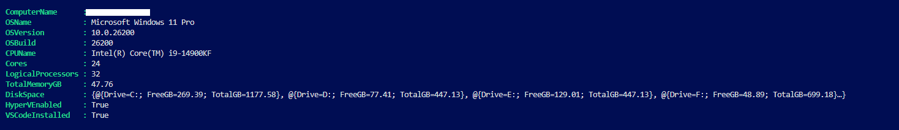

# SK-IT Windows Server 2025 Automation Project :- Technical Reference 

Welcome to the Technical Reference Guide for the SK-IT Windows Server 2025 Automation Project. This document details the configurable parameters, architecture, and core technologies that drive the workflows across this automation project.

**Note:** If you want to get your lab up and running quickly, please complet the steps listed in the [Project Prerequisites & Deployment Guide](Project-prerequisites-deployment.md).

However, to get a solid grasp of how this automation project operates — if you have the time — reading through this Technical Reference and its accompanying documents is recommended.

**Personal Note:** I hope you find this automated lab useful! Please feel free to open a support ticket [SK-IT Support Portal](https://sk-it-helpdesk.atlassian.net/servicedesk/customer/portals), to help with any issues you have or indeed leave feedback. You can email me directly with any questions or queries at [spencer@sk-it.co.uk](mailto:spencer@sk-it.co.uk).


### Table of Contents
1. [📁 Repository Structure](#repository-structure)
2. [🖥️ Host Environment & Hardware Sizing](#host-environment)
3. [💾 Storage Planning & Dedicated Drive Placement](#storage-planning)
4. [🛡️ pfSense Network Isolation Guide](#pfsense-network-isolation-guide)
5. [🧑‍💻 Visual Studio Code & Development Tools](#visual-studio-code)
6. [🔑 Administrator Credentials & Single-Injection](#administrator-credentials)
7. [🪟 Windows ISOs, Checksums](#windows-isos)
8. [⚙️ Packer Configuration & Output Customization](#packer-configuration)
9. [🤖 The Automation pipeline & Unattended.XML](#automation-pipeline)


---
**Quick Links:** [Read Me](../README.md) | [Project Customisation](Customise-your-Infrastructure.md) | [pfSense Configuration](PfSense-configuration.md) | [Project Prerequisites & Deployment Guide](Project-prerequisites-deployment.md) |

---
<br>

## Quick Technology Overview
This section provides a brief technical snapshot of the core technologies, design choices, and architectural considerations implemented across this automation project, more in-depth sections are listed below.

### 🛡️ Network Isolation Using pfSense
> pfSense handles all routing and perimeter isolation for the Hyper-V VMs, ensuring zero traffic, DHCP conflicts, or DNS leakage reach the physical host network. It also provides the capability to configure site-to-site IPsec VPN tunnels, VLAN segmentation, and hybrid cloud connectivity to Microsoft Azure should you need it in the future.

### 💾 Project Storage Requirements & Host Environment
> For lab storage, a dedicated 400 GB SSD partition was provisioned specifically for VHDXs, raw ISO media, and virtual machines. This provides ample headroom for node expansion and multi-VM deployments. For detailed hardware breakdowns and capacity calculations, see [💾 Storage Planning & Dedicated Drive Placement](#storage-planning) and [🖥️ Host Environment & Hardware Sizing](#host-environment).

### ⚙️ Infrastructure Customization
> You can tailor the infrastructure to match your host hardware: By default, this lab provisions 2× Domain Controllers (to test replication and provide HA), 2× Member Servers (allocated for Exchange, Azure Hybrid, or Entra Connect), and 1× Windows 11 client (for Windows Admin Center, FSLogix profiles, and Group Policy validation). If host resources are constrained, you can easily scale down to a minimal single DC and Windows 11 client deployment.
>
> Forest and domain names, IP subnets, and VM memory allocations are fully customizable depending on your lab requirements. See [⚙️ Project Customization](Customise-your-Infrastructure.md) for details on modifying configuration parameters.

### 🧑‍💻 Visual Studio Code Integration
> Visual Studio Code serves as the unified administrative operations console, providing a single pane of glass across multiple environments (Windows, Linux, Azure, etc.). For recommended workspace configurations and required extensions, see [🧑‍💻 Visual Studio Code & Development Tools](#visual-studio-code) below.

### 🔑 Administrator Credentials & Windows ISOs
> This pipeline has been engineered around a single credential injection point: you declare your administrative password once, and the orchestrator propagates it securely through each stage of the build. The evaluation ISOs (Windows Server 2025 and Windows 11) must be downloaded, renamed, and placed into the designated project directory. See [🔑 Administrator Credentials & Single-Injection](#administrator-credentials) and [🪟 Windows ISOs & Checksums](#windows-isos) for detailed setup instructions.

### 🤖 The Automation Pipeline & Sysprep Unattended Considerations
> The [🤖 The Automation Pipeline & Unattended.xml](#automation-pipeline) section provides an end-to-end breakdown of the deployment pipeline, detailing the execution sequence of each script, expected stage behaviors, and verified console outputs. This section also explores how `Autounattend.pkrtpl.hcl` and `unattend.pkrtpl.hcl` handle automated provisioning and Sysprep routines.

### 📁 Repository Structure & Storage Planning
> The [📁 Repository Structure](#repository-structure) section outlines the complete directory layout for this repository. Review it to confirm all files, scripts, answer templates, and media are placed correctly prior to triggering execution. The storage planning section covers partition configuration, IOPS requirements, and dynamic disk expansion across your dedicated storage drive.


---
<br><br>

# 1. 📁 Project folder structure (after cloning the repository) <a id="repository-structure"></a>

<details>
<summary><strong>📁 (Click to expand) Verify all files are placed into the correct directories. While folder paths can be customized, this framework operates as a self-contained project; keeping the existing layout is recommended. Increase window width for better formatting.</strong></summary
<br>
<pre>
Automated-WindowsServer2025-EnterpriseLab/
├── <a href="../.gitignore">.gitignore</a>                                   # Excludes logs, caches, and ISOs
├── <a href="../build.pkr.hcl">build.pkr.hcl</a>                                # Packer VHD build parameters/
├── <a href="../Deploy_Automation_Project.ps1">Deploy_Automation_Project.ps1</a>                # Bootstrap 
├── <a href="../lab-wipe.ps1">lab-wipe.ps1</a>                                 # Teardown tool to delete all VMs 
├── <a href="../LICENSE.txt">LICENSE.txt</a>                                  # Open-source license declaration
├── <a href="../packer-debug.log">packer-debug.log</a>                             # Debug execution output and 
├── <a href="../packer.auto.pkrvars.hcl">packer.auto.pkrvars.hcl</a>                      # Automated variable 
├── <a href="../packer.exe">packer.exe</a>                                   # HashiCorp Packer execution binary
├── <a href="../README.md">README.md</a>                                    # Primary project overview and 
├── <a href="../variables.pkr.hcl">variables.pkr.hcl</a>                            # Custom Parameter 
│
├── docs/
│   ├── <a href="Customise-your-Infrastructure.md">Customise-your-Infrastructure.md</a>          # Guide for tailoring/customising Hyper-V VM 
│   ├── <a href="PfSense-configuration.md">PfSense-configuration.md</a>                  # How to build an isolated 
│   ├── <a href="Project-prerequisites-deployment.md">prerequisites and deployment.md</a>           # Explains the project prerequisites & give deployment instructions 
│   └── <a href="Technical-Reference.md">Technical-Reference.md</a>                    # Detailed architectural & technical manual/guide
│
├── images/
│   ├── Automation-stages                        # Terminal logs and completion captures for pipeline stages
│   ├── Guest-configuration-vaidation            # Verification screenshots of finished Active Directory services 
|   ├── Hyper-v                                  # Hyper-V Manager settings and virtual switch configurations  
|   ├── Packer-execution                         # Step-by-step console output captures during Packer builds
│
├── ISOs/
│   ├── Win11ClientEntEval.iso                   # Renamed (Win11ClientEntEval) Windows 11 Enterprise evaluation media ISO
│   └── WinServer2025Eval.iso                    # Renamed (WinServer2025Eval) Windows Server 2025 evaluation media ISO
│
├── hyper-VM_source/
│   ├── <a href="../hyper-VM_source/unattend-win11.pkrtpl.hcl">unattend-win11.pkrtpl.hcl</a>                 # Windows 11 automated response template (Sysprep)
│   └── <a href="../hyper-VM_source/unattend.pkrtpl.hcl">unattend.pkrtpl.hcl</a>                       # Server 2025 automated response template (Sysprep)
│
├── Hyper-V_VMs/                                  # Hyper-V VM storage folder - includes config files/VHDXs
│
├── packer_cache/                                 # HashiCorp Packer download cache and temporary working files
│
├── scripts/
│   ├── <a href="../scripts/bootstrap-win11.ps1">bootstrap-win11.ps1</a>                       # Configures WinRM over HTTPS for Packer on Windows 11
│   ├── <a href="../scripts/bootstrap-winrm-https.ps1">bootstrap-winrm-https.ps1</a>                 # Configures WinRM over HTTPS for Packer, disables BL for (Sysprep)
│   ├── <a href="../scripts/cleanup-server2025.ps1">cleanup-server2025.ps1</a>                    # Sysprep cleanup tasks for Windows Server 2025
│   ├── <a href="../scripts/cleanup-win11.ps1">cleanup-win11.ps1</a>                         # Sysprep cleanup tasks for Windows 11
│   └── <a href="../scripts/Environment_Hardware_Specs.ps1">Environment_Hardware_Specs.ps1</a>            # Host hardware audit inspection script
│
├── SK-Automation-Scripts/
│   ├── <a href="../SK-Automation-Scripts/01_SK_Automation-Host_CreateVM.ps1">01_SK_Automation-Host_CreateVM.ps1</a>        # Creates VMs based on array list + JSON configuration
│   ├── <a href="../SK-Automation-Scripts/02_SK_Automation-Host_VMConfigTest.ps1">02_SK_Automation-Host_VMConfigTest.ps1</a>    # Tests PowerShell Direct guest connectivity
│   ├── <a href="../SK-Automation-Scripts/03_SK_Automation-Host_VMConfigDeploy.ps1">03_SK_Automation-Host_VMConfigDeploy.ps1</a>  # Injects IPs, gateway, and hostnames via JSON
│   ├── <a href="../SK-Automation-Scripts/04_SK_Automation-Host_PromoteRootDC.ps1">04_SK_Automation-Host_PromoteRootDC.ps1</a>   # Promotes Forest Root DC (SRV-DC1)
│   ├── <a href="../SK-Automation-Scripts/05_SK_Automation-Host_NodeJoin.ps1">05_SK_Automation-Host_NodeJoin.ps1</a>        # Promotes Replica DC & joins member fleet
│   ├── <a href="../SK-Automation-Scripts/06_SK_Automation-Host_CustomConfigs.ps1">06_SK_Automation-Host_CustomConfigs.ps1</a>   # Sets DHCP, Corp OU/Users & purges caches
│   ├── <a href="../SK-Automation-Scripts/SK_Automation-host_The-One-Ring.ps1">SK_Automation-host_The-One-Ring.ps1</a>       # Master orchestrator (single-click pipeline)
│   └── <a href="../SK-Automation-Scripts/SK_Automation-VMConfig.json">SK_Automation-VMConfig.json</a>               # Manifest defining IPs, hostnames, and AD roles etc
│
└── templates/
    ├── <a href="../templates/Autounattend-Win11.pkrtpl.hcl">Autounattend-Win11.pkrtpl.hcl</a>             # Answer file template for Windows 11
    └── <a href="../templates/Autounattend.pkrtpl.hcl">Autounattend.pkrtpl.hcl</a>                   # Answer file template for Windows Server 2025
</pre>
</details>

---
<br><br>

# 2. 🖥️ Host Environment <a id="host-environment"></a>
This section outlines the host hardware and software environment used to build and test this project. It establishes an operational baseline so you know the hardware profile the automation project was developed on and the build performance you can expect.

The environment was built on a Windows 11 Pro physical workstation with Hyper-V enabled, running a virtualized pfSense instance for network boundary isolation (as well as future site-to-site VPN, VLAN, and Azure Hybrid connectivity). Visual Studio Code was used as the primary management and orchestration console. 

The physical hardware baseline specifications are captured below (my workstation runs an RTX 5090—totally, unnecessary for this automation project, but a flex nonetheless!). Minimum host system requirements are detailed in the [Prerequisites](#project-prerequisites) section.



### Baseline Capacity & Sizing
For this baseline deployment, five virtual machines are provisioned (by default), consuming roughly 300+ GB of dedicated SSD space - the memory, vCPU allocation, is variable and can be fully customised. 

Since this is my personal testing environment, I designed this specific five-node layout (the default layout) to mirror a small functional corporate hybrid infrastructure:

* **`SRV-DC1` (Root Domain Controller):** The forest root domain for AD DS, DNS, and DHCP.
* **`SRV-DC2` (Replica Domain Controller):** Provides high availability and redundancy, provides replication testing, site topology, failover behavior and disaster recovery.
* **`SRV-EX01` (Exchange / Mail Workload Server):** Dedicated member server staged for testing on-premises Exchange administration, messaging flow, and mail-enabled attributes.
* **`SRV-MS01` (Hybrid Member Server):** Staged for hybrid cloud integration, Microsoft Entra Connect directory sync, and Windows Admin Center gateway management.
* **`CLI-WIN11-01` (Windows 11 Enterprise Client):** Domain-joined workstation used to validate Group Policy application, test end-user authentication (SSO), test client software deployments, and evaluate FSLogix profile and user share control.

This structure gives me a realistic corporate simulation for day-to-day administration, hands-on lab experiments, and certification prep.

> **Sizing Flexibility:** As stated - your physical host does not need to match these exact resource allocations. The lab topology scales dynamically based on your available host RAM, vCPU cores, and disk capacity. If your host has at least **32 GB of RAM** and **350 GB of free SSD storage** dedicated to Hyper-V, you can retain all default sizing parameters and simply customize the VM hostnames, domain names, or IP addressing. 

For full details on resource calculations and configuration parameters, see the [⚙️ Infrastructure Customization](Customise-your-Infrastructure.md) guide.

---
<br><br>

# 3. 💾 Storage Planning & Dedicated Drive Placement <a id="storage-planning"></a>

This automation framework operates as a **completely self-contained project**. All raw evaluation ISOs, temporary Packer build VM's, packer golden image (VHDX), and cloned Hyper-V virtual hard drives live directly inside the repository tree.

### Storage Capacity Planning (Full Independent Clones)
The pipeline uses **full independent disk clones**. Each spawned virtual machine receives its own dedicated, dynamically expanding 60 GB generalized VHDX copied directly from the Packer golden image, ensuring complete isolation and independence across all guest nodes.

The default baseline storage footprint breaks down as follows:

* **Windows Server 2025 Golden VHDX:** ~16 GB base template  - the size would obviously increase if you provison your own installed apps.
* **Windows 11 Enterprise Golden VHDX:** ~18 GB base template
* **ISO Staging Folder (`ISOs/`):** ~12 GB (downloaded Server and Client evaluation media from MS)

* **Provisioned Cloned VMs:** You can customise the size of each Packer VHDx, please see project customisations.
  * **Default Dynamic Limit:** **60 GB** Each Packer VHDX is 60GB in size, by default.(`disk_size = 61440`, `disk_block_size = 1`) they are dynamically expanding per node (`SRV-DC1`, `SRV-DC2`, member servers, and Windows 11 clients). 

  * **Customization & Overhead:** While each cloned guest disk has a maximum expansion ceiling of 60 GB (350 GB required by default), actual consumption begins at roughly 15–20 GB per VM upon initial boot. You can adjust this ceiling in the Packer configuration templates (e.g., down to 35–40 GB per node) if host drive capacity is tight. 
  
  The 60 GB default ensures sufficient headroom for Windows updates, Active Directory database growth, and test software. Additional secondary virtual data disks (VHDXs) can be attached via Hyper-V Manager or PowerShell after deployment of course.

* **Total Storage Baseline:** Plan for **250 GB to 350 GB+** of free space on a fast NVMe or SSD volume when deploying the default five-node topology.

> **Storage Optimization Tip:** If your physical drive space is limited, you can set your `$VMList` array to clone only a single Root DC and one Windows 11 client workstation. This minimal setup requires roughly **70–90 GB** of total disk space while maintaining a fully functional Active Directory test lab. [Project Customisation](docs/Customise-your-Infrastructure.md).  In the prerequisistes section, you will be able to target your git-clone repository to a specific drive, directory.

---
<br><br>

# 4. 🛡️ pfSense Network Isolation Guide <a id="pfsense-network-isolation-guide"></a>
Hyper‑V vSwitches act as virtual Ethernet switches, and when you attach one to a VM’s Network Adapter (like the pfSense VM created for this automation project), pfSense sees that connection as a virtual NIC. pfSense runs on FreeBSD (the OS underneath pfSense), and FreeBSD labels those virtual NICs as hn0 and hn1. 

This architecture creates a direct 1:1 mapping between your Hyper-V virtual switches and pfSense logical interfaces:
* **`lab-switch-wan` $\rightarrow$ `hn0` $\rightarrow$ WAN (`192.168.0.#`):** Binds directly to your physical host network adapter to receive an IP via DHCP from your home or office router, providing outbound internet access.
* **`lab-switch-lan` $\rightarrow$ `hn1` $\rightarrow$ LAN (`10.0.0.254`):** Placed on a Private Hyper-V switch completely isolated from your physical network. All automated lab VMs attach exclusively here.

In short, Hyper-V manages the Layer 2 switching, while pfSense functions as the Layer 3 perimeter gateway handling default routing, outbound NAT, and firewall filtering.  You can change the vSwitch names,
but I strongly recommend leaving them with the names listed in the below guide, as these vSwitches (`lab-switch-wan`|`lab-switch-lan`) are called throughout various stages in this automated project.  

For a more indepth look at pfSense that provides quick easy-to-follow guide (Youtube video) on how to setup (download link provided) **[Go here](PfSense-configuration.md)**. Note: This project's pfSense settings replicate those in the video guide.

---
<br><br>

# 5. 🧑‍💻 Visual Studio Code <a id="visual-studio-code"></a>
Visual Studio Code serves as my administrative terminal console across multiple environments:
* Interfaces directly with the Hyper-V host and VMs, using PowerShell Direct to orchestrate each automation stage.
* Triggers and monitors Packer builds, utilizing `$env:PACKER_LOG=1` for real-time console debugging - very handy for getting a good understanding of the Packer workflow.
* Provides a structured folder workspace, so you can create a master tree of folders, from different projects, scripts, templates and technical documentation in one place. Once you have your directory tree setup, make sure you create a workspace and save it.

> 📦 **Packer Included:** This project repository already includes `packer.exe` in the root folder, so you do not need to download or install  Packer separately. 

>Important: Always start Visual Studio Code as an Administrator, in every session. This goes for Hyper-V manager as well.

---
<br><br>

# 6. 🔑 Administrator Credentials <a id="administrator-credentials"></a>
To make this automation project seamless, I wanted to eliminate the frustration of re-typing passwords across multiple scripts. In a lab environment, repeatedly typing credentials invites typos, breaks unattended runs, and normally means hardcoding plain-text passwords.

Instead, this automation pipeline uses an single injection point: you declare your administrator password once, and the master orchestrator `(SK_Automation-host_The-One-Ring.ps1)` carries it securly through every stage of the build:

* **Stage 1:** Base golden image creation (Packer WinRM & initial local admin)
* **Stage 2.1:** Hyper-V VM provisioning & disk cloning
* **Stage 2.2:** Guest connectivity verification via PowerShell Direct
* **Stage 2.3:** Network identity & hostname injection
* **Stage 3.1:** Forest root bootstrap & promotion to Domain Admin
* **Stage 3.2:** Replica DC promotion & member fleet domain joins
* **Stage 3.3:** Enterprise service configuration, user account seeding & credential sanitization

>Note: Please make sure your password meets the complexity requirements of the password policy. Strong passwords require a combination of uppercase and lowercase letters, numbers, and symbols.
If you do not, the automation proccess will halt during the configuration of the Directory Services Restore Mode.
   ---
<br><br>

# 7. 🪟 Windows ISOs and Checksums <a id="windows-isos"></a>

## Required Evaluation Media
* [Windows Server 2025 Datacenter (Desktop Experience) Evaluation](https://www.microsoft.com/en-gb/evalcenter/download-windows-server-2025)
* [Windows 11 Enterprise Evaluation (English - Great Britain)](https://www.microsoft.com/en-gb/evalcenter/download-windows-11-enterprise)

Once downloaded, place both ISO images into the `/ISOs` directory using these exact filenames:
* `WinServer2025Eval.iso`
* `Win11ClientEntEval.iso`

> **Note:** This project operates as a **completely self-contained repository**. All raw evaluation ISOs, temporary Packer builds, master golden VHDXs, and cloned virtual machines live directly inside the repository tree. I strongly recommend sticking to the default directory paths. ---

## Customizing ISO Names, Golden VHDX Paths & Output Folders

If you do want to set your own custom ISO name and output directories, update both the Packer variable declarations and the host provisioning scripts below.

### 1. Update Media & Output Variables
Found in `variables.pkr.hcl` (and overridden in `packer.auto.pkrvars.hcl` if defined):

```hcl
# ------------------------------------------------------------------------------
# Windows Server 2025 Media & Output
# ------------------------------------------------------------------------------
variable "iso_url" {
  type        = string
  description = "Path to the Windows Server 2025 installation ISO"
  default     = "ISOs/WinServer2025Eval.iso" # Change ISO path/filenames here!
}

variable "output_directory" {
  type        = string
  description = "Destination folder for finalized Server 2025 master VHDX"
  default     = "./output-ws2025-master-vhd" # Change Sysprep output directory
}

# ------------------------------------------------------------------------------
# Windows 11 Media & Output
# ------------------------------------------------------------------------------
variable "iso_url_win11" {
  type        = string
  description = "Path to the Windows 11 installation ISO"
  default     = "ISOs/Win11ClientEntEval.iso" # Change ISO path/filename
}

variable "output_directory_win11" {
  type        = string
  description = "Destination folder for finalized Windows 11 master VHDX"
  default     = "./output-win11-master-vhd"  # Change output directory
}
``` 
---

### 2. Update Host Provisioning Paths
If you alter the output directories or VHDX file names above for the Packer Golden VHDX, you must update the host deployment script so the provisioning engine can locate and clone the golden disks for Hyper-V.
Found in `01_SK_Automation-Host_CreateVM.ps1:`

```powershell
# Explicit VHDx mappings- using OS tags - to actual Packer output VHDX filenames listed above
$GoldenImages = @{
    "Win2025" = Join-Path $ProjectRoot "output-ws2025-master-vhd\Virtual Hard Disks\Win2025-GoldenImage-Build.vhdx"
    "Win11"   = Join-Path $ProjectRoot "output-win11-master-vhd\Virtual Hard Disks\Win11-GoldenImage-Build.vhdx"
}
```
Essentially changing where the master disks are built means you must also tell the VM creation script where to look so it can copy them. But I recommend leaving the default - self-contained - values.  

**Important:** In the `variables.pkr.hcl`, the variable "switch_name" needs to point to the pfSense wan connected (via DHCP) interface. if this network switch name does not match your real Hyper-V > pfSense > Host setup, Packer cannot connect to the internet or finish building the machines.

```
#---------------------------------
variable "switch_name" {
  type        = string
  description = "Hyper-V Virtual Switch to bind the VM during the Packer Stage 1 - the pipeline will crash if this is not named correctly."
  default     = "lab-switch-wan"
}
```
### 3. Change the Hyper-V VM's output location
if you want to change the output VM location from the Hyper-V_VMs directory to another directory - edit this code in
`01_SK_Automation-Host_CreateVM.ps1`
```Powershell
# Target directory where individual VM configuration folders and cloned VHDXs reside
$VMPath = Join-Path -Path $ProjectRoot -ChildPath "Hyper-V_VMs"
if (-not (Test-Path -Path $VMPath)) {
    New-Item -ItemType Directory -Path $VMPath -Force | Out-Null
}
```
---

### 4. Adding your ISO Hash to the packer.auto.pkvars.hcl
To get your Hash:
```Powershell
# If you changed the default path / ISO file name, obviously enter that here.

# Check Windows Server 2025 ISO Hash
Get-FileHash -Path .\ISOs\WinServer2025Eval.iso -Algorithm SHA256 | Select-Object -ExpandProperty Hash

# Check Windows 11 Enterprise ISO Hash
Get-FileHash -Path .\ISOs\Win11ClientEntEval.iso -Algorithm SHA256 | Select-Object -ExpandProperty Hash
```
After you get the Hash seqennce - go to `packer.auto.pkrvars.hcl` and enter the hash - make sure you add the prefix sha256: 

```text
# The credentials declared here serve as the root identity across the entire pipeline:
admin_username = "Administrator"
admin_password = "YourSecurePassword123!"

# Windows Evaluation ISO Checksums (Pre-populated) - please see ISO for more information regarding the ISO's.
iso_checksum       = "sha256:7B052573BA7894C9924E3E87BA732CCD354D18CB75A883EFA9B900EA125BFD51"
win11_iso_checksum = "sha256:6E861B93EB9501182AD2E4DC3FA8C411AFB6D7ED86A8CCBE37CA67D75470B95F"
```
---
<br><br>

# 8. ⚙️ Packer Configuration <a id="packer-configuration"></a>
HashiCorp Packer automates the build of the base operating systems, producing fully Sysprepped, generalized VHDX master images. Once the build completes, Packer exports these finalized virtual disks into their respective output directories. From there, the Hyper-V host provisioning scripts clone these images to spawn your lab nodes, after which PowerShell Direct takes over via the VMBus to orchestrate guest configuration completely hands-free.

To inspect or modify hardware sizing, boot configurations, answer file injection, or Sysprep behavior, review **[`build.pkr.hcl`](../build.pkr.hcl)**. Like every script in this repository, it is thoroughly documented with inline comments explaining each configuration block. The core sections of `build.pkr.hcl` are detailed below:

---

### SECTION 1: PACKER ENGINE & PLUGIN SETUP
* Declares the minimum required Packer core engine version (`>= 1.10.0`) and pulls the official HashiCorp Hyper-V builder plugin (`hashicorp/hyperv`) required to interface with the local hypervisor.

### SECTION 2: BUILDER SOURCE (Windows Server 2025)
* Configures the automated generation of the Windows Server 2025 Datacenter (Desktop Experience) master VHDX.
* Defines the baseline Generation 2 virtual hardware profile (RAM, vCPUs, dynamic disk parameters).
* Attaches the unattended ISO installation media (`templates/Autounattend.pkrtpl.hcl`) to automate disk partitioning and bypass initial setup screens.
* Establishes a temporary self-signed WinRM HTTPS listener (via `scripts/bootstrap-winrm-https.ps1`) for Packer communicator access.
* Executes Sysprep generalization (`sysprep.exe /generalize /oobe /shutdown`) to seal the master image.

### SECTION 3: BUILDER SOURCE (Windows 11 Enterprise)
* Mirrors Section 2 but targets Windows 11 Enterprise evaluation media, incorporating specific platform parameters:
* Configures vTPM and Secure Boot prerequisites required for Windows 11 Generation 2 VM deployment.
* Bypasses client-specific OOBE hardware gating and Microsoft Account (MSA) setup prompts via `templates/Autounattend-Win11.pkrtpl.hcl`.
* Configures the client WinRM provisioning channel via `scripts/bootstrap-win11.ps1`.

### SECTION 4: PROVISIONING PIPELINE
* Executes in-guest servicing, tooling injection, and pre-sealing tasks on both master images before final shutdown:
* **Tooling Injection:** Bakes administrative software (such as PowerShell 7) directly into the image so nodes boot ready for enterprise automation.
* **OS Sanitization:** Invokes `scripts/cleanup-server2025.ps1` and `scripts/cleanup-win11.ps1`. On Windows 11, this specifically decrypts pre-provisioned BitLocker volumes and strips provisioned AppX packages that commonly block Sysprep generalization.
* **Answer File Staging:** Injects credential-templated `unattend.xml` answer files directly into `C:\Windows\Panther\` on each master VHDX, readying them for instant specialization during Stage 2 cloning.

---
## Using Pre-Existing Sysprepped VHDXs (Bypassing Stage 1)

If you already maintain your own generalized, Sysprepped VHDX images and want to skip the Packer build stage entirely, you can invoke the master orchestrator with the `$SkipPackerBuild` switch parameter:

```powershell
# In SK_Automation-host_The-One-Ring.ps1:
# Set this to $true (or pass -SkipPackerBuild) to jump directly to Stage 2 VM cloning
param(
    [switch]$SkipPackerBuild = $true
)

# Then place your Sysprepped VHDX into the variables.pkr.hcl output_directory.
# the  ./output-ws2025-master-vhd folder is created automaticlaly by Packer. Place your VHDx image in folder.

variable "output_directory" {
  type        = string
  description = "Destination folder for finalized Server 2025 master VHDX"
  default     = "./output-ws2025-master-vhd" # Change Sysprep output directory
}

```
---

<br><br>

# 9. 🤖 The Automation pipeline & Unattended.XML files <a id="automation-pipeline"></a>
## Pipeline Architecture, Script Manifest & Outputs

1. **Order:** The execution sequence of the scripts.
2. **Script Name:** The filename of each automation script.
3. **Stage:** The associated project deployment phase.
4. **Description:** A concise breakdown of the actions performed during that stage.
5. **Output Capture:** Visual confirmation of Packer and PowerShell Direct terminal output.
6. **Guest Configurations:** Verified operational status of the provisioned Hyper-V guest VMs.

| Order | Script / File Name | Stage | Description | Output Capture |
| :---: | :--- | :--- | :--- | :--- |
| **00** | `Deploy_Automation_Project.ps1` | Entry Point | Bootstrap launcher. Resolves repository root paths, validates build files, verifies orchestrator existence, and initiates execution. | [Deploy](images/Packer-execution/Deploy.png) |
| **01** | `the-one-ring.ps1` | Orchestrator | Pipeline controller. Captures administrative credentials, sets environment variables, and executes Stages 1 through 6 sequentially with strict fail-fast error handling. | *Console output* |
| **02** | `Build.pkr.hcl` | Stage 1 | Invokes Packer to perform unattended OS installations, producing clean, sysprepped base VHDXs for Windows Server 2025 and Windows 11. | [Validate Start](images/Packer-execution/Stage1_validate-start.png) · [Validate Finish](images/Packer-execution/Stage1a_validate-finish.png) · [Sysprep](images/Packer-execution/Stage1b_Sysprep.png) · [OS Install](images/Packer-execution/Stage1c_OS-installaion.png) · [WinRM (Server 2025)](images/Packer-execution/Stage1d_expectedOutput-WinRMSer2025-Connected.png) · [WinRM (Win 11)](images/Packer-execution/WinSer2025_WinRM-Connected.png) · [Cleanup Script](images/Packer-execution/Stage1e_cleanup-script-execution.png) · [Build Complete](images/Packer-execution/Stage1f_finished-succesfully.png) |
| **03** | `01_SK_Automation-Host_CreateVM.ps1` | Stage 2.1 | Allocates Hyper-V compute resources from the `$VMList` array, generates cloned VHDXs linked to the golden images, and boots all guest VMs. | [Stage 2.1 Completed](images/Automation-stages/Stage2_1-completed.png) |
| **04** | `02_SK_Automation-Host_VMConfigTest.ps1` | Stage 2.2 | Executes pre-flight checks across all VMs to verify guest OS initialization and ensure healthy PowerShell Direct communication over the VMBus. | [Stage 2.2 Completed](images/Automation-stages/Stage2_2-completed.png) |
| **05** | `03_SK_Automation-Host_VMConfigDeploy.ps1` | Stage 2.3 | Ingests `SK_Automation-VMConfig.json` via PowerShell Direct to configure static networking, DNS resolvers, and computer hostnames. | [Stage 2.3 Completed](images/Automation-stages/Stage2_3-completed.png) |
| **06** | `04_SK_Automation-Host_PromoteRootDC.ps1` | Stage 3.1 | Connects to `SRV-DC1` via VMBus, installs AD DS and DNS roles, and promotes the server to Root Domain Controller for the new forest. | [Stage 3.1 Completed](images/Automation-stages/Stage3_1-completed.png) |
| **07** | `05_SK_Automation-Host_NodeJoin.ps1` | Stage 3.2 | Defines AD replication sites/subnets, promotes `SRV-DC2` as a replica domain controller, and joins member servers and clients to the domain. | [Stage 3.2 Completed](images/Automation-stages/Stage3_2-completed.png) |
| **08** | `06_SK_Automation-Host_CustomConfigs.ps1` | Stage 3.3 | Installs and authorizes AD-integrated DHCP on the root DC, builds organizational units (`OU=Corp_OU`, `OU=Corp_Accounts`), seeds 10 department test users, and purges setup caches. | [Stage 3.3 Completed](images/Automation-stages/Stage3_3-completed.png) |
| **Config** | `SK_Automation-VMConfig.json` | Configuration | Central JSON configuration file defining hostnames, static IPs, subnet masks, DNS forwarders, and domain roles consumed across all automation stages. | *Configuration file* |

---

#### Verified Guest Configurations
| [AD Computer Accounts](images/Guest-configuration-vaidation/Guest-Confirmation_AD-computer-accounts.png) | [AD Users](images/Guest-configuration-vaidation/Guest-Confirmation_AD-users.png) | [Domain Controllers](images/Guest-configuration-vaidation/Guest-Confirmation_DCs.png) | [DHCP Scope](images/Guest-configuration-vaidation/Guest-Confirmation_DHCP.png) | [DNS Records](images/Guest-configuration-vaidation/Guest-Confirmation_DNS.png) | [DNS Forwarders](images/Guest-configuration-vaidation/Guest-Confirmation_DNS-Forwarders.png) |

---

## The Unattended Automation (Sysprep & OOBE)
The following unattended template files automate operating system deployment across two key provisioning stages:

1. **Initial OS Installation (Autounattend.pkrtpl.hcl via Packer):** Automates the unattended setup directly from raw the downloaded ISOs. This stage partitions the virtual disk, selects the target OS index, applies UK locale/regional configurations, and configures temporary WinRM access for Packer orchestration.   

2. **First-Boot Customisation (Unattend via Sysprep):** Executes during the specialized Out-of-Box Experience (OOBE) when a cloned VM boots for the first time in Hyper-V. It generates unique machine SIDs, provisions the local administrator credentials, and ensures guest services are ready for PowerShell Direct management.

**The .xml files**
* **[Autounattend.pkrtpl.hcl](/templates/Autounattend.pkrtpl.hcl)**
  * **Stage:** OS installation Windows Server 2025 Datacenter (Desktop Experience) (IMAGE_INDEX 2).
  * **Role:** Partitions virtual disks, selects the server edition index, applies UK regional settings, and configures WinRM for Packer provisioning.

* **[Autounattend-Win11.pkrtpl.hcl](/templates/Autounattend-Win11.pkrtpl.hcl)**
  * **Stage:** OS installation Windows 11 Desktop (IMAGE_INDEX 3).
  * **Role:** Partitions virtual disks, selects the server edition index, applies UK regional settings, and configures WinRM for Packer provisioning.

* **[unattend.pkrtpl.hcl](/hyper-VM_source/unattend.pkrtpl.hcl)**
  * **Stage:** Sysprep & First Boot (Server Clones).
  * **Role:** Applied during Server generalization to assign unique SIDs, set permanent local credentials, and enable PowerShell Direct ready for stage 2.

* **[unattend-win11.pkrtpl.hcl](/hyper-VM_source/unattend-win11.pkrtpl.hcl)**
  * **Stage:** Sysprep & First Boot (Client Clones).
  * **Role:** Applied during Client generalization to assign unique SIDs, set permanent local credentials, and enable PowerShell Direct ready for stage 2.

> **Note on `.pkrtpl.hcl` Files:** The `.pkrtpl.hcl` extension designates these as Packer HCL templates rather than static XML files. This approach keeps your XML definitions modular, reusable, and free of plaintext secrets. Sensitive variables are populated dynamically at runtime from **[`packer.auto.pkrvars.hcl`](../packer.auto.pkrvars.hcl)**. You only define credentials once during setup, and these become your primary administrative login credentials across the domain. See [🔑 Administrator Credentials](#administrator-credentials) for full configuration details.

During deployment, the automation pipeline generates these four unattended setup answer files containing the administrator credentials entered in `packer.auto.pkrvars.hcl`. Leaving unattended answer files on disk is an enterprise security risk, as anyone with local file read permissions could recover the plain-text credentials.

So to follow industry best security practices, this pipeline enforces a multi-stage cleanup process that purges all traces of these setup answer files:

   * Stage 1 (Sysprep Image Sealing): Cleans initial Panther caches and unmounts the virtual media hosting Autounattend.xml.

   * Stage 2 (Hyper-V Specialization): Windows processes Sysprep specialization on first boot, temporarily generating local setup cache files.

   * Stage 3.3 (Node-Wide Sanitization): Explicitly purges remaining setup XML files and sanitizes C:\Windows\Panther\ across all provisioned virtual machines.  (`06_SK_Automation-Host_CustomConfigs.ps1 > Part C`)
---

Please now read through the [Project Prerequisites & Deployment Guide](docs/Project-prerequisites-deployment.md).